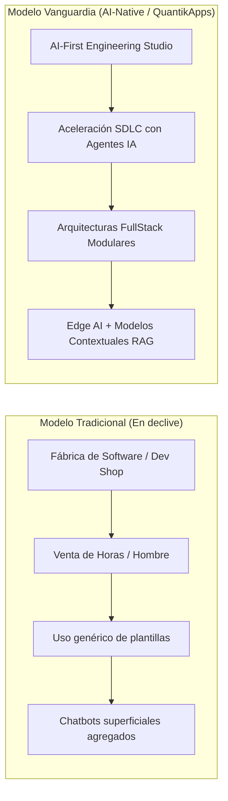
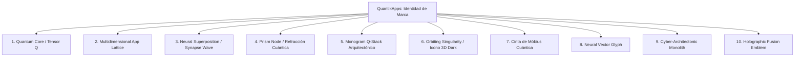

# Investigación de Mercado & Plan de Identidad: QuantikApps

## Goal Description
Desarrollar y generar **10 propuestas visuales únicas de logo (.png)** para la firma **QuantikApps**, perteneciente a un desarrollador FullStack Web/Móvil con enfoque **AI-First**.

Además, se incluye una **investigación profunda sobre las agencias y firmas líderes de desarrollo web/móvil actuales**, sus tendencias de arquitectura de software, modelos de negocio y la corriente de diseño de identidad visual que domina la industria tecnológica moderna.

---

## 1. Investigación de Mercado: Firmas Top y Tendencias Actuales

### 1.1 El Cambio de Paradigma: De "Dev Shop" a "AI-Native Product Studio"
Las agencias de desarrollo líderes a nivel global (*Clay Global, The Gradient, Fantasy, Metalab, Droids On Roids, Vercel/Linear Ecosystem*) han dejado atrás el modelo clásico de "fábrica de software por horas". El mercado actual se divide claramente en dos:

### 1.2 Tendencias Tecnológicas en Desarrollo Web & Móvil
1. **Agentic Workflows & AI-Assisted SDLC**: Las firmas de élite no solo desarrollan productos con IA; la utilizan intrínsecamente en su ciclo de vida de desarrollo (asistentes autónomos, generación de tests, refactorización y despliegue continuo), reduciendo los tiempos de entrega hasta un 50%.
2. **On-Device / Edge AI en Móvil**: En lugar de enviar cada petición a la nube, las aplicaciones móviles modernas procesan embeddings y modelos SLM (*Small Language Models*) directamente en el dispositivo (iOS/Android) para latencia cero y total privacidad.
3. **Interfaces Adaptativas e Hiperpersonalizadas**: La UI ya no es estática; muta y se reconfigura en tiempo real según los hábitos y contexto del usuario mediante inferencia de IA.
4. **FullStack Moderno Unificado**: Adopción de arquitecturas reactivas y serverless de alto desempeño (Next.js, Remix, Flutter, React Native, Kotlin Multiplatform, Supabase, Postgres vectorial).

---

### 1.3 Tendencias en Branding e Identidad Visual (La corriente *Linear / Vercel / Raycast*)
En el mundo de los desarrolladores y las startups de software de alto nivel, existe una estética dominante que transmite ingeniería de élite:

* **Dark-First Architecture**: No es negro plano (#000000), sino tonos carbón y obsidiana profunda (`#0A0A0C`, `#0E131F`, `#121620`) que eliminan la fatiga visual y confieren un aspecto ultra-premium y elegante.
* **Luminous Accents (Acentos Neón Cuánticos)**: Uso selectivo y quirúrgico de gradientes luminosos: azul eléctrico, cian cuántico y destellos de violeta/índigo sobre fondos oscuros.
* **Geometría Funcional & Anti-Generic**:
  - Se evitan por completo los clichés antiguos (el átomo genérico de clipart de los 2000s, el robot infantil o el globo terráqueo con flechas).
  - Predominan los **monogramas matemáticos, isotipos basados en nodos, topología cuántica (cintas de Möbius, prismas de refracción) y estructuras modulares isométricas** que representan capas de código y tensores de datos.
* **Tipografía Neo-Grotesk & Monospace**: Diseños que combinan tipografías geométricas ultra-legibles (*Inter, Geist, SF Pro*) con toques sutiles de estética de terminal de código (monospace) para reafirmar la maestría técnica.

---

## 2. Aplicación a QuantikApps: Posicionamiento de Marca

Para que **QuantikApps** se posicione como una firma boutique de alto impacto, el logotipo debe comunicar:
1. **Ingeniería Robusta (FullStack)**: Estructuras ordenadas, arquitecturas modulares, precisión milimétrica.
2. **Inteligencia y Vanguardia (AI-First + Quantik)**: Nodos interconectados, estados de superposición, haces de luz coherente, singularidades de cómputo.
3. **Elegancia y Sobriedad**: Presencia visual que inspire confianza ejecutiva tanto a startups como a corporaciones.

---

## 3. Matriz Conceptual de los 10 Logos (.png)

| ID Archivo | Concepto | Enfoque Semiótico | Paleta Dominante |
|---|---|---|---|
| `logo_01_quantum_core.png` | **The Quantum Core / Tensor Q** | Singularidad cuántica + Letra Q estilizada | Negro Obsidiana, Azul Cobalto, Titanio |
| `logo_02_multidimensional_lattice.png` | **Multidimensional App Lattice** | Capas de arquitectura FullStack isométricas | Gris Grafito, Bordes Cian Eléctrico |
| `logo_03_neural_superposition.png` | **Neural Superposition Wave** | Ondas de probabilidad y sinapsis IA fluida | Azul Medianoche, Violeta Cuántico, Cyan |
| `logo_04_prism_refraction.png` | **Prism Node / Refracción** | Prisma oscuro con refracción de datos lumínicos | Obsidiana, Azul Zafiro, Toques Índigo |
| `logo_05_monogram_q_stack.png` | **Monogram Q-Stack** | Tipografía monolítica modular (Frontend + Backend + AI) | Titanio Cepillado, Azul Royal, Carbón |
| `logo_06_orbiting_singularity.png` | **Orbiting Singularity (App Icon)** | Relieve 3D moderno con anillo orbital levitante | Carbón Mate, Núcleo Azul Profundo, Cyan |
| `logo_07_mobius_ribbon.png` | **Cinta de Möbius Cuántica** | Flujo continuo de datos e iteración ágil | Metal líquido oscuro, Reflejos Zafiro |
| `logo_08_neural_vector_glyph.png` | **Neural Vector Glyph** | Red neuronal vectorial angular de precisión matemática | Grafito, Cyan bioluminiscente, Plata |
| `logo_09_architectonic_monolith.png` | **Cyber-Architectonic Monolith** | Hexágono segmentado revelando un procesador cuántico | Gris espacial, Neón Azul Cobalto |
| `logo_10_holographic_fusion.png` | **Holographic Fusion Emblem** | Código abstracto transformándose en ondas cuánticas | Negro puro, Degradado Azul-Púrpura etéreo |

---

## 4. User Review Required

> [!IMPORTANT]
> **Preguntas de Confirmación**:
> 1. ¿Te hace sentido este enfoque de alineación con la estética contemporánea de firmas de software de alta gama (*Dark-First, minimalismo geométrico, destellos azul/cyan/índigo*)? Si
> 2. ¿Deseas que los logos se generen principalmente como **Isotipo / Isologotipo** (símbolo + nombre "QuantikApps" con tipografía de precisión) o prefieres que algunos sean puramente **íconos de aplicación / glifos**? SI

---

## 5. Execution Plan

1. **Creación de Entorno**: Crear la carpeta `logos/` en `C:\xampp\htdocs\quantikapps\logos`.
2. **Generación con Subagente Especializado**: Utilizar `image-generator` para sintetizar cada propuesta con composiciones centradas, iluminación de estudio en modo oscuro, renderizado vectorial y 3D de alta fidelidad.
3. **Organización y Reporte**: Guardar los 10 archivos `.png` en `logos/`, crear copias en la carpeta de artefactos y compilar un reporte `walkthrough.md` con carrusel interactivo para comparar y elegir.
